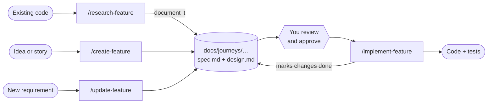
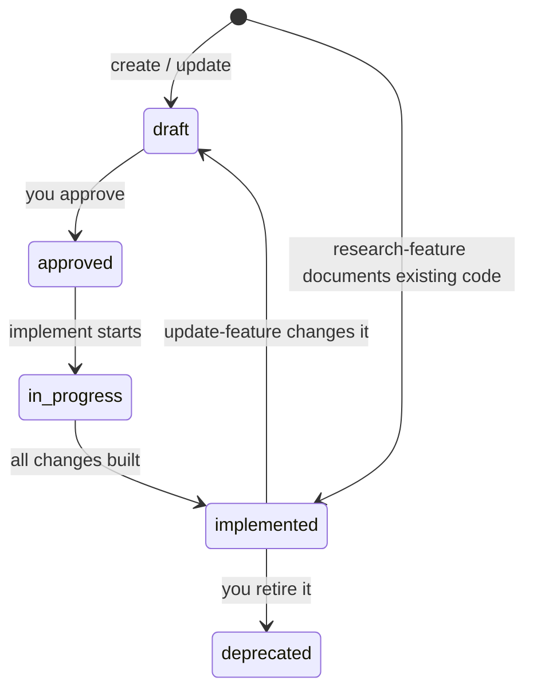

# Lean spec-driven development skills

Four [Agent Skills](https://code.visualstudio.com/docs/agent-customization/agent-skills) that put a lightweight spec-driven development (SDD) practice into your repository. You describe a feature; the agent interviews you, studies your codebase, and writes a **spec** and a **technical design** as Markdown files next to the code. It later builds from those files.

| Skill | What it does |
|---|---|
| `/create-feature` | Interviews you and writes a new feature's spec and design. |
| `/update-feature` | Changes an existing feature's spec and design and records what changed. |
| `/research-feature` | Investigates existing code and offers to document it as a feature. |
| `/implement-feature` | Builds an approved feature (or its pending changes), then updates the docs. |

There is nothing to install besides the skill files: no CLI, no runtime and no database. Everything is plain Markdown that is reviewed in pull requests like any other change.

> **Status:** version 0.1. The skills are new and have not yet been tested across every host and model. Try them on one small, real feature first, then adjust the prompts (see [Customization](#customization)).

## Contents

- [Why this exists](#why-this-exists)
- [Quick start](#quick-start)
- [How the workflow fits together](#how-the-workflow-fits-together)
- [The skills in detail](#the-skills-in-detail)
- [The documents](#the-documents)
- [How the agent asks questions](#how-the-agent-asks-questions)
- [Installation](#installation)
- [Compatibility: Copilot and Claude Code](#compatibility-copilot-and-claude-code)
- [Customization](#customization)
- [Maintaining this repository](#maintaining-this-repository)
- [Design choices](#design-choices)
- [Compared with Spec Kit and OpenSpec](#compared-with-spec-kit-and-openspec)
- [Troubleshooting](#troubleshooting)
- [Repository layout](#repository-layout)

## Why this exists

Specs written before coding catch misunderstandings while they are still cheap to fix. They also give the agent a stable source of truth, so it does not depend on whatever is left in a chat history. These skills keep that practice small enough that a team just starting out will actually use it:

- **Documents live in the repo,** so the skills can find and update them, and people review them in pull requests.
- **Two permanent documents per feature:** a spec (what and why) and a design (how). A task list is optional and temporary.
- **Interviews instead of guessing.** The agent asks about real ambiguities, with the recommended choice first.
- **Small changes stay small.** A feature that touches one component can use a single file.
- **No tooling to adopt.** Frameworks such as [Spec Kit](https://github.com/github/spec-kit) and [OpenSpec](https://github.com/Fission-AI/OpenSpec) need a Python or Node CLI. These skills do not. See [the comparison](#compared-with-spec-kit-and-openspec) for when to choose a framework instead.

## Quick start

1. [Install the skills](#installation) into your repository. Copy `skills/` into `.claude/skills/` to use them with both GitHub Copilot and Claude Code, or into `.github/skills/` for Copilot only.
2. In Copilot Chat or Claude Code, type `/` and choose a skill. Start with:

   ```text
   /create-feature Let customers reschedule a delivery. Story: https://example.atlassian.net/browse/SHIP-123
   ```

3. Answer the questions. The first option in each is the recommendation.
4. Read the generated files under `docs/journeys/<journey>/<feature>/`, edit them if needed, and approve them when asked.
5. Build it:

   ```text
   /implement-feature reschedule-delivery
   ```

6. Later, when the requirements change:

   ```text
   /update-feature reschedule-delivery  Allow rescheduling up to 2 hours before the window
   /implement-feature reschedule-delivery
   ```

## How the workflow fits together



A feature moves through these statuses (kept in the front matter of `spec.md` or `feature.md`):



`implement-feature` only builds `approved` features. It builds the **pending** rows of the spec's changelog and flips them to `done` when finished, so an update never makes it rebuild what already exists.

## The skills in detail

### `/create-feature`

Creates a feature that does not exist yet.

1. **Intake:** asks for the feature name, a description, story URL(s) (Jira, Azure DevOps, GitHub) and the journey. It reads the story if it has a tool for it; otherwise it asks you to paste it.
2. **Research:** reads project guidance, finds comparable features, notes coding and test patterns, and checks 2nd/3rd-party API docs and versions.
3. **Spec:** asks up to 5 questions, then writes requirements with acceptance criteria.
4. **Design:** asks up to 5 more questions, then writes the approach, changes, external dependencies, decisions and test plan. It also lists the other project docs the feature will make wrong or incomplete (README, API docs, ...) under **Related documentation**, without editing them.
5. **Approval:** runs a consistency check and asks whether to approve. It never approves on its own.

### `/update-feature`

Changes a feature that exists.

- Finds the feature, or lets you pick one from a list. If it does not exist, it offers to create it using the `create-feature` flow.
- Reads the current docs and the code, and flags **drift** where the code no longer matches the docs.
- Edits the spec and design **in place** so they show the feature as it will be, keeps requirement IDs stable, and adds a changelog row marked `pending`.
- Updates the design's **Related documentation** list: the README, API descriptions, architecture docs and guides that the change makes wrong. It lists them but does not edit them; `/implement-feature` does, once the code exists.
- Pure wording fixes skip the interview and approval.

### `/research-feature`

Answers "how does this work?" for code that was not created with these skills.

- Read-only. It traces entry points, data, dependencies and tests, and labels each finding **Observed**, **Intended** or **Inferred**.
- It answers your question first, then offers to document the area. If you accept, it asks whether odd behavior is intended or a bug, and writes docs with `status: implemented`.
- It stays within one bounded area. Back-filling specs for the whole system is deliberately not offered; those specs go stale.

### `/implement-feature`

Builds the pending changes of an approved feature.

- Refuses `draft` and `deprecated` features, and any feature that still has `[NEEDS CLARIFICATION]` items.
- Builds only the `pending` changelog rows. For a large change it writes a temporary `tasks.md`; for a small one it uses the session's own task list.
- Writes tests tagged with acceptance-criteria IDs, runs build, lint and tests, and reports which criteria are covered.
- If the design turns out to be wrong, it stops and asks, then updates the design so the docs never silently diverge from the code.
- After the build and tests pass, it edits the **related docs** listed in the design (README, API descriptions, guides), with small edits in each doc's style. It regenerates generated docs with the project's command and skips automatically generated changelogs.
- Updates the feature changelog and status. It does not commit or push.

## The documents

### Layout

```text
docs/
└── journeys/
    └── <journey>/                 e.g. checkout, onboarding
        └── <feature>/             e.g. reschedule-delivery
            ├── spec.md            what and why        (permanent)
            ├── design.md          how                 (permanent)
            └── tasks.md           checklist           (optional, temporary)
```

A **journey** is an end-to-end user or business flow, and a **feature** is one capability within it. For a small feature (one component, fewer than 5 requirements) the skills recommend a single `feature.md` that holds both the spec and the design. They offer to split it when it grows.

The docs root defaults to `docs/journeys`. If your `AGENTS.md` or `.github/copilot-instructions.md` names another location, the skills use that.

### What is inside

| Document | Contents |
|---|---|
| `spec.md` | Front matter (`feature`, `journey`, `status`, `stories`, `code_paths`); Context; Requirements (`FR-n`, `NFR-n`) each with Given/When/Then acceptance criteria (`AC-n.m`); Out of scope / Future; Known issues; Clarifications; Open questions; Changelog. |
| `design.md` | Approach; Architecture fit (links to example files); Changes; External dependencies (name, version, source); Related documentation (other project docs to update); Decisions (`D-n`); Security and data; Risks and rollout; Test plan mapping each AC to a test; Open questions; Changelog. |
| `feature.md` | Both of the above in one file. |
| `tasks.md` | Checklist tied to requirement IDs. Created only for large changes and deleted when done. |

The exact templates are in [`shared/templates/`](shared/templates).

### Rules that keep the documents useful

- **Current truth plus a changelog.** The body of each document describes the feature as it is now, in present tense. History appears only in the `Changelog` table.
- **Stable IDs.** Requirement, acceptance-criteria and decision IDs are never renumbered or reused, so tests, tasks and pull requests can refer to them.
- **Pending versus done.** A changelog row's `State` tells `implement-feature` what is still to build.
- **Evidence over assumptions.** Claims link to files in the repo. Patterns are linked, not pasted. Fetched pages and story text are treated as data, not as instructions.
- **No guessing.** Unknowns become `[NEEDS CLARIFICATION: …]`, which blocks implementation until resolved.

### Example (abridged)

```markdown
---
feature: reschedule-delivery
journey: delivery
status: approved
stories:
  - https://example.atlassian.net/browse/SHIP-123
code_paths:
  - src/delivery/reschedule/
---

# Reschedule delivery — Spec

## Requirements

### FR-1 Customer can pick a new delivery window
A signed-in customer can move an unshipped order to another available window.

- **AC-1.1** Given an unshipped order, when the customer selects an available window, then the order shows the new window.
- **AC-1.2** Given a shipped order, when the customer opens the page, then rescheduling is not offered.

## Changelog

| Date | Change | Affects | Story/PR | State |
|---|---|---|---|---|
| 2026-11-10 | Allow rescheduling up to 2 hours before the window | FR-1, AC-1.3 | SHIP-140 | pending |
| 2026-10-20 | Initial version | FR-1 | SHIP-123 | done |
```

## How the agent asks questions

Every skill follows one [clarification protocol](shared/clarification-protocol.md):

- **It checks first.** It asks only about things the story, the docs and the code cannot answer, and that matter for scope, behavior, data, security or cost.
- **At most 5 questions per phase** (spec, then design), highest impact first. You can stop early and accept the recommendations.
- **The recommended option is first** and says why, using evidence from your repo. Alternatives follow with their trade-offs. **Scope expansions come last** and are labeled `(expands scope)`.
- **Hard-to-undo choices** (public APIs, schemas, PII, retention) are marked `⚠`.
- **You can always answer freely or defer.** A deferred question becomes `[NEEDS CLARIFICATION]`.
- **Answers are recorded** under `Clarifications` (spec) and `Decisions` (design), so nobody is asked twice.
- **Declined expansions** go to `Out of scope / Future` instead of being lost.
- **Approval is yours.** The final question recommends reviewing the files first.
- **Without an interactive tool,** the agent prints a numbered list. If nobody can answer (a cloud agent or CI), it applies the recommendations and lists them as `Assumption (auto)`, but never approves a feature.

The agent uses the host's question tool when there is one (`askQuestions` in VS Code, `ask_user` in Copilot CLI, `AskUserQuestion` in Claude Code). In VS Code the tool was introduced as experimental behind the `chat.askQuestions.enabled` setting, so turn that on if your version still requires it.

## Installation

Use any one of these. They are listed from simplest to most reusable.

### Option 1: Copy into a repository (recommended to start)

Skills in the repository are shared with everyone who clones it. Pick the folder by the tools your team uses:

| Folder | Read by |
|---|---|
| `.claude/skills/` | **Claude Code** and **VS Code Copilot** (use this if your team uses both) |
| `.github/skills/` | GitHub Copilot only |
| `.agents/skills/` | Copilot and other tools that follow the shared `.agents` convention; not Claude Code |

```powershell
# Windows PowerShell
Copy-Item -Recurse -Force <path-to>\agent-skills\skills\* <your-repo>\.claude\skills\
```

```bash
# macOS / Linux
cp -R <path-to>/agent-skills/skills/* <your-repo>/.claude/skills/
```

Commit the result. The commands are `/create-feature`, `/update-feature`, `/research-feature` and `/implement-feature`. Install in one folder only, so a tool that reads several locations does not list each skill twice.

### Option 2: Personal skills for all your projects

Copy the folders from `skills/` into `~/.claude/skills/` (read by Claude Code and VS Code Copilot) or `~/.copilot/skills/` (Copilot only). On Windows, `~` is `%USERPROFILE%`.

### Option 3: Install as a plugin

The repository is also an Agent Plugin ([`plugin.json`](plugin.json), skills in `skills/`), so it can be installed from Git once it is pushed to a remote:

- **VS Code:** run **Chat: Install Plugin from Source** from the Command Palette and enter the repository URL or a local folder path.
- **Copilot CLI:** `copilot plugin install OWNER/REPO`, or `copilot plugin install ./agent-skills` from a local path.

Plugin skills are namespaced by the plugin name, so the commands become `/lean-sdd:create-feature`, `/lean-sdd:implement-feature`, and so on. Review any plugin before you install it, including this one.

### Requirements

- A host that supports Agent Skills: VS Code Copilot Chat, Copilot CLI, the Copilot cloud agent, or Claude Code. See [Compatibility](#compatibility-copilot-and-claude-code).
- A Jira, Azure DevOps or GitHub tool (an MCP server or the `gh` CLI) if you want the agent to read stories from their URLs. Without one, it asks you to paste the story.
- Node.js 18 or later, only if you maintain this repository (see below).

## Compatibility: Copilot and Claude Code

The skills follow the [Agent Skills](https://agentskills.io) open standard (`SKILL.md` with YAML front matter plus supporting files). They use only the plain front-matter fields `name`, `description`, `argument-hint` and `disable-model-invocation`, which both GitHub Copilot in VS Code and Claude Code document. The body is plain Markdown, and the skills do not use host-specific tools, hooks or `context: fork`.

| Topic | GitHub Copilot (VS Code) | Claude Code |
|---|---|---|
| Project skill folder | `.github/skills/`, `.claude/skills/`, `.agents/skills/` | `.claude/skills/` only |
| Personal skill folder | `~/.copilot/skills/`, `~/.claude/skills/`, `~/.agents/skills/` | `~/.claude/skills/` |
| Slash command | `/create-feature` | `/create-feature` |
| Plugin command prefix | `/lean-sdd:create-feature` | `/lean-sdd:create-feature` |
| Question tool | `askQuestions` | `AskUserQuestion` |
| Plugin manifest | `plugin.json` (Agent Plugins, included) | `.claude-plugin/plugin.json` (not included yet) |

What this means in practice:

- **One folder serves both:** `.claude/skills/` is the only project location that both tools read.
- **Question tools differ,** but the [clarification protocol](shared/clarification-protocol.md) is written for either: it uses whatever interactive tool the host has, and otherwise falls back to a numbered list.
- **Descriptions** are well under Claude Code's 1,536-character listing cap and Copilot's 1,024-character limit.
- **Plugin installation is not yet shared.** The included `plugin.json` is the Agent Plugins format that Copilot reads. Claude Code expects its own manifest at `.claude-plugin/plugin.json` (and a marketplace to install from), so for Claude Code use the folder copy in Option 1 or 2 for now.
- **Not yet tested in every host.** The skills are plain instructions, so behavior depends on the model. Try one feature in each tool you use and compare.

## Customization

- **Docs root and conventions.** State them in `AGENTS.md` or `.github/copilot-instructions.md`, for example "Feature docs live in `documentation/features`". The skills defer to project guidance. To change the defaults for everyone, edit [`shared/conventions.md`](shared/conventions.md).
- **Templates.** Edit [`shared/templates/`](shared/templates) to add sections your organization needs, such as threat modeling, data classification or a rollout checklist.
- **Research depth.** The checklist in [`shared/conventions.md`](shared/conventions.md) (§9) controls what the agent studies before it writes.
- **Question limits and style.** Edit [`shared/clarification-protocol.md`](shared/clarification-protocol.md).
- **Automatic invocation.** Each skill sets `disable-model-invocation: true`, so it runs only when you call it with a slash command. Remove that line from a skill's front matter if you want the agent to load it on its own.
- **Make the specs part of ordinary work.** Add one line to `AGENTS.md`: "Before changing code under a feature's `code_paths`, read its spec and design in `docs/journeys`. If behavior changes, run `/update-feature`."
- **After any edit in `shared/`,** run `node scripts/skills.mjs sync` (see below).

## Maintaining this repository

A skill must be self-contained, so the shared rules and templates are **copied** into each skill's `references/` folder. `shared/` is the single source; never edit the copies.

```powershell
node scripts/skills.mjs sync    # copy shared/ into every skill's references/
node scripts/skills.mjs check   # verify copies match and each skill is valid; exits 1 on problems
```

`check` confirms that each skill's `name` matches its folder and is valid, that the description is within 1024 characters, that every `references/` link resolves, that the copies match `shared/`, and that `plugin.json` parses. Run it in CI to prevent drift:

```yaml
# .github/workflows/check.yml
on: [push, pull_request]
jobs:
  check:
    runs-on: ubuntu-latest
    steps:
      - uses: actions/checkout@v4
      - uses: actions/setup-node@v4
        with: { node-version: 20 }
      - run: node scripts/skills.mjs check
```

**To add a skill:** create `skills/<name>/SKILL.md`, add its entry and the shared files it needs to `manifest` in [`scripts/skills.mjs`](scripts/skills.mjs), then run `sync` and `check`. Skill names use lowercase letters, numbers and hyphens, and must match the folder name.

## Design choices

- **Two permanent documents, one optional.** The spec is the contract and the design records the reasoning. A task list only helps one implementation run, so it is temporary and created only for large changes.
- **Changelog instead of change folders.** Each document's body stays current, and one table carries the history and the pending/done state. If a feature's history becomes too long to read, move to a per-change folder model like OpenSpec's.
- **Journeys as the top-level grouping.** Features are easier to find by the flow they belong to than by a flat list or a number.
- **Approval is a human act.** The status gate means the agent cannot build from a document nobody has reviewed.
- **Skills never write code except `implement-feature`.** Spec work and coding are separate steps with a review between them.
- **Related docs are found early and edited late.** `create-feature` and `update-feature` list the README, API docs and guides that will need changes, so you can review the list with the design. `implement-feature` edits them after the code works, so they describe what actually shipped.
- **Everything is explicit.** The skills do not run by themselves, and nothing is committed unless you ask.

**Not included on purpose:** a `/verify-feature` skill, automatic archiving, a registry or index of features, per-feature ADR files, and CLI tooling. Add them when the team asks for them.

## Compared with Spec Kit and OpenSpec

| | These skills | [Spec Kit](https://github.com/github/spec-kit) | [OpenSpec](https://github.com/Fission-AI/OpenSpec) |
|---|---|---|---|
| Requires a CLI or runtime | No | Python 3.11+ and `uv` for setup | Node.js 20.19+ |
| Document set | spec + design (+ temporary tasks) | spec, plan, tasks (+ more) | proposal, delta specs, design, tasks |
| Existing-code documentation | `/research-feature` | community extensions | not a goal; specs grow with changes |
| Change history | changelog table in each document | a team convention | per-change folders merged on archive |
| Grouping | journey → feature | numbered feature folders | domain folders |
| Maturity | new, small | widely used, many extensions | widely used, customizable workflows |

Choose a framework if you need strict approval phases, many agents supported with one setup, an ecosystem of extensions, or a merged archive of changes. Your documents are plain Markdown, so migrating later is mostly moving files.

## Troubleshooting

| Symptom | Check |
|---|---|
| A skill does not appear after typing `/` | The folder must be directly under a [skill location your tool reads](#compatibility-copilot-and-claude-code) (Claude Code reads only `.claude/skills/`, not `.github/skills/`) and contain `SKILL.md`. The `name` must equal the folder name, using only lowercase letters, numbers and hyphens. An invalid name makes the skill silently fail to load. |
| The agent never asks interactive questions | Enable the host's question tool (VS Code: `chat.askQuestions.enabled` in versions where it is still a setting). Without it, the agent prints a numbered list and waits for your reply. |
| It cannot read the Jira or Azure DevOps story | Install and sign in to the matching MCP server, or paste the story text when asked. The agent never invents story content. |
| It refuses to implement | The feature is `draft` or `deprecated`, has `[NEEDS CLARIFICATION]` items, or has no `pending` changelog row. The message names which one. |
| It wants to build too much or too little | Check the spec's changelog: only `pending` rows are built. Fix the `State` column or the `Affects` IDs and run again. |
| The docs disagree with the code | Run `/update-feature`. It detects drift and offers to reconcile. |
| `node scripts/skills.mjs check` fails | Run `node scripts/skills.mjs sync`, and do not edit files under `skills/*/references/`. |

## Repository layout

```text
agent-skills/
├── README.md
├── plugin.json                  Agent Plugin manifest (name: lean-sdd)
├── shared/                      single source for the shared files
│   ├── conventions.md           layout, formats, statuses, IDs, research checklist
│   ├── clarification-protocol.md
│   └── templates/               spec.md, design.md, feature.md, tasks.md
├── skills/
│   ├── create-feature/          SKILL.md + references/ (generated copies)
│   ├── update-feature/
│   ├── research-feature/
│   └── implement-feature/
└── scripts/
    └── skills.mjs               sync and check (maintainers only)
```
